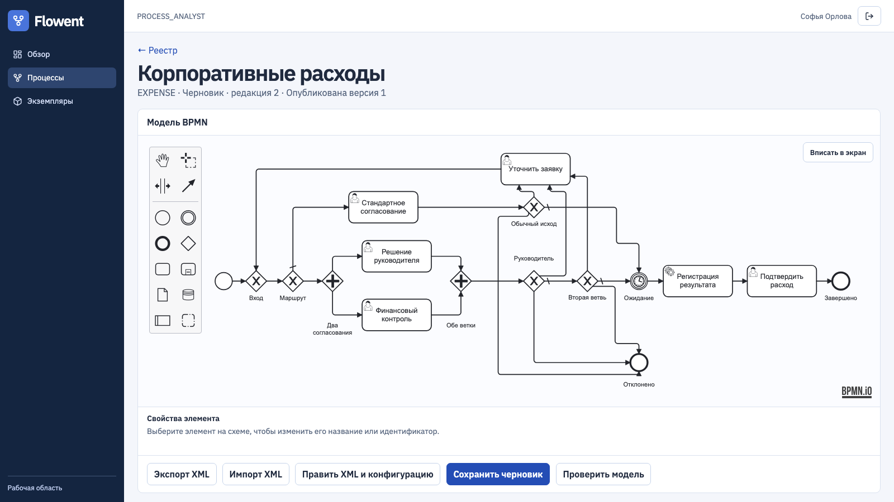

# Flowent

Flowent executes a defined subset of BPMN 2.0. Import or edit a model, publish an immutable version and run instances backed by PostgreSQL. Track human tasks, parallel branches, timers, SLA and service incidents from the workspace.

[Русский](README.ru.md) · [English](README.en.md) · [OpenAPI](docs/openapi.json) · [Verification](docs/verification.md)

[Full-size screenshot · Полноразмерный скриншот](assets/screenshots/expense-editor.png)

Start with `docker compose up --build --wait` and open the [local workspace](http://127.0.0.1:8120).

Запустите той же командой и откройте рабочее пространство. В MVP доступны согласования расходов, ИТ-доступа и командировок, а также изолированная лаборатория исполнения. [Статус и ограничения](docs/PROJECT_STATUS.md)
