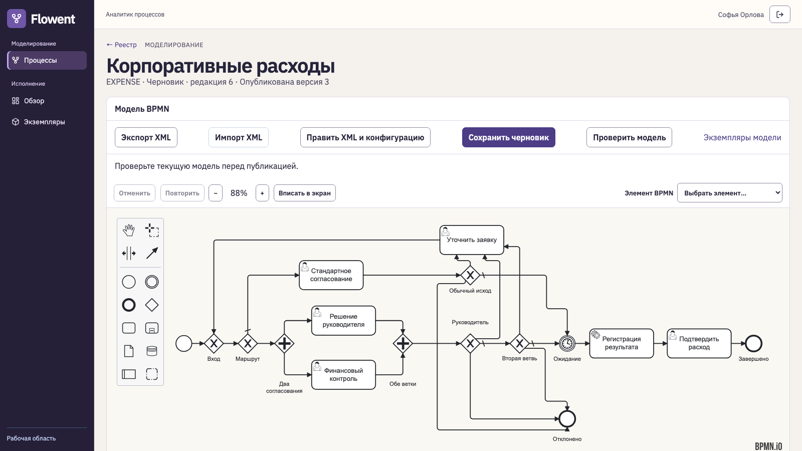
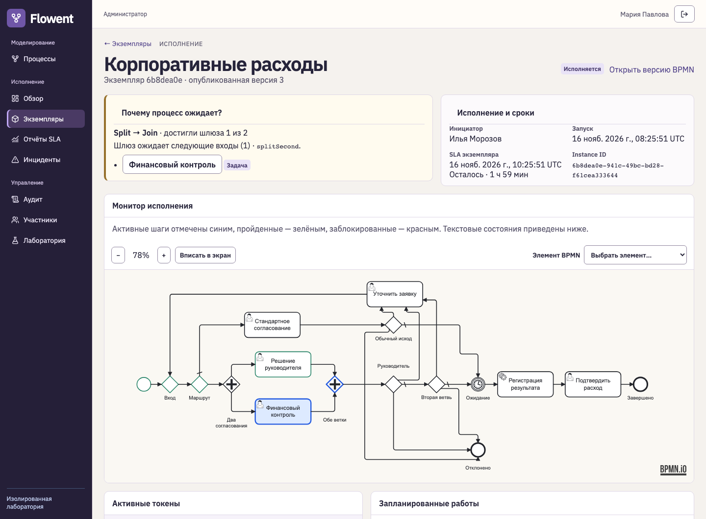

# Demonstration / Демонстрация

Запустите [изолированную среду](../README.ru.md) и войдите под `admin`. В «Лаборатории» запустите параллельное согласование. После первой ветви проверка `join_waits` показывает сохранённое ожидание. После второй в журнале появляется ровно один `JOINED`. Разверните HTTP-трассу и сопоставьте идентификаторы запросов с историей.

Затем войдите под `analyst`. В «Процессах» экспортируйте модель расходов, импортируйте XML в новый черновик и измените название задачи на диаграмме. Сохраните и проверьте черновик. Под `manager` опубликуйте версию, под `employee` запустите экземпляр с суммой 12 000 ₽, затем под `approver` завершите согласование. В мониторе проверьте маршрут, таймер и вновь открывшуюся задачу. Вернитесь под `employee` и подтвердите расход. В [тесте Playwright](../frontend/e2e/flow.spec.ts) эти шаги выполняются через интерфейс.

## Screenshots / Скриншоты

Chromium и реальные ответы изолированного демонстрационного стенда PostgreSQL. Цвета на схеме отражают текущее состояние зафиксированных токенов. Скриншот редактора в полном размере — 1600 × 900 px.

| Экран | Полный размер |
| --- | --- |
| Рабочая область моделирования | [PNG](../assets/screenshots/design-workspace.png) |
| Редактор BPMN | [PNG](../assets/screenshots/expense-editor.png) |
| Инспектор свойств BPMN | [PNG](../assets/screenshots/properties.png) |
| Ошибка валидации | [PNG](../assets/screenshots/validation-error.png) |
| Снимок опубликованной модели | [PNG](../assets/screenshots/published-model.png) |
| Реестр моделей процессов | [PNG](../assets/screenshots/registry.png) |
| Реестр экземпляров | [PNG](../assets/screenshots/instance-registry.png) |
| Model-to-Execution Workbench · обзор разделов | [PNG](../assets/screenshots/dashboard.png) |
| Runtime BPMN Viewer | [PNG](../assets/screenshots/runtime-viewer.png) |
| Ожидание Parallel JOIN | [PNG](../assets/screenshots/join-wait.png) |
| Активная пользовательская задача | [PNG](../assets/screenshots/active-task.png) |
| Результат выполнения задачи | [PNG](../assets/screenshots/task-completion.png) |
| Ожидание BPMN-таймера | [PNG](../assets/screenshots/timer-wait.png) |
| Нарушение SLA | [PNG](../assets/screenshots/sla-breach.png) |
| Карточка инцидента | [PNG](../assets/screenshots/incident-details.png) |
| История восстановления | [PNG](../assets/screenshots/recovery-history.png) |
| Переход из экземпляра к закреплённому XML | [PNG](../assets/screenshots/version-navigation.png) |
| Мобильный просмотр экземпляра · 390 px | [PNG](../assets/screenshots/mobile-viewer.png) |
| Flowent Lab | [PNG](../assets/screenshots/lab.png) |
| Входящие задачи | [PNG](../assets/screenshots/inbox.png) |
| Контекст задачи | [PNG](../assets/screenshots/task-details.png) |
| Динамическая форма задачи | [PNG](../assets/screenshots/task.png) |
| Успешная проверка BPMN | [PNG](../assets/screenshots/validation.png) |
| История публикаций | [PNG](../assets/screenshots/versions.png) |
| Монитор тестового согласования | [PNG](../assets/screenshots/monitor.png) |
| Отчёты SLA | [PNG](../assets/screenshots/reports.png) |
| Журнал инцидентов | [PNG](../assets/screenshots/incidents.png) |

[Скачать запись реального исполнения](../assets/demo/flowent.mp4). Запись относится к версии до редизайна. Она объединяет прогон от редактирования до завершения экземпляра и проверку параллельного шлюза через Lab. Все кадры получены из локального окружения с синтетическими данными.
