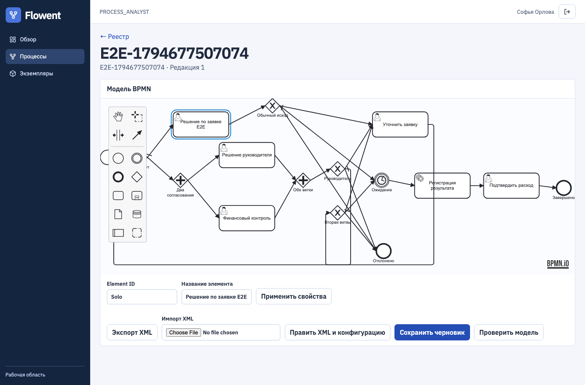
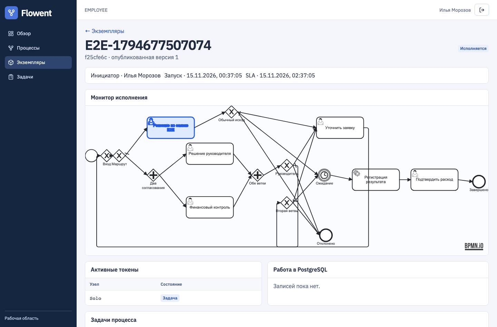

# Demonstration / Демонстрация

Запустите [изолированную среду](../README.ru.md) и войдите под `admin`. В «Лаборатории» запустите параллельное согласование. После первой ветви проверка `join_waits` показывает сохранённое ожидание. После второй в журнале появляется ровно один `JOINED`. Разверните HTTP-трассу и сопоставьте идентификаторы запросов с историей.

Затем войдите под `analyst`. В «Процессах» экспортируйте модель расходов, импортируйте XML в новый черновик и измените название задачи на диаграмме. Сохраните и проверьте черновик. Под `manager` опубликуйте версию, под `employee` запустите экземпляр с суммой 12 000 ₽, затем под `approver` завершите согласование. В мониторе проверьте маршрут, таймер и вновь открывшуюся задачу. Вернитесь под `employee` и подтвердите расход. В [тесте Playwright](../frontend/e2e/flow.spec.ts) эти шаги выполняются через интерфейс.

## Captures

| Экран | Снимок |
| --- | --- |
| Обзор рабочей области | [Dashboard](../assets/screenshots/dashboard.png) |
| Реестр | [Process registry](../assets/screenshots/registry.png) |
| Редактор | [BPMN designer](../assets/screenshots/designer.png) |
| Валидация | [Validation](../assets/screenshots/validation.png) |
| Публикация и история версий | [Versions](../assets/screenshots/versions.png) |
| Очередь задач | [Task inbox](../assets/screenshots/inbox.png) |
| Карточка задачи | [Task details](../assets/screenshots/task-details.png) |
| Динамическая форма | [Dynamic form](../assets/screenshots/task.png) |
| Монитор исполнения | [Execution monitor](../assets/screenshots/monitor.png) |
| Отчёт по срокам | [SLA reports](../assets/screenshots/reports.png) |
| Инциденты | [Incident log](../assets/screenshots/incidents.png) |
| Лаборатория | [Flowent Lab](../assets/screenshots/lab.png) |

[Скачать запись реального исполнения](../assets/demo/flowent.mp4). Короткая запись Playwright объединяет прогон от редактирования до завершения экземпляра и проверку параллельного шлюза через Lab. Все кадры получены из локального окружения с синтетическими данными.
